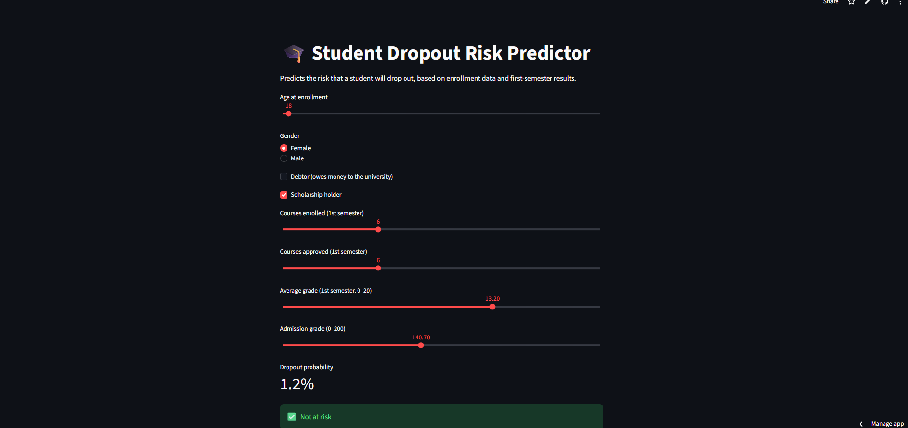
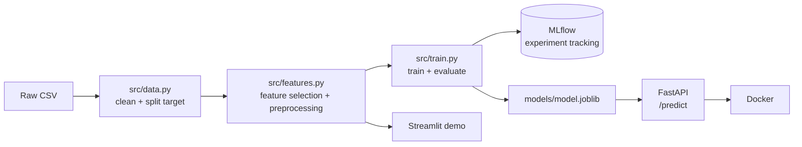

# 🎓 Student Dropout Prediction


[](https://student-dropout-predictor-demo.streamlit.app/)

An end-to-end machine learning project that predicts which university students are at risk of dropping out, so universities can **support them early**.

**👉 [Try the live demo](https://student-dropout-predictor-demo.streamlit.app/)**



---

## 💡 Motivation

Before moving into software engineering and machine learning, I worked as a school teacher. I saw how students who start to fall behind are often noticed too late. This project explores how a simple, explainable model can help a university find at-risk students **at the end of the first semester**, while there is still time to help.

## 📊 Data

- **Source:** *Predict Students' Dropout and Academic Success*, UCI Machine Learning Repository (data from a higher education institution in Portugal)
- **Size:** 4,424 students, 36 features (personal, family, financial, enrollment and academic data)
- **Target:** `Dropout`, `Enrolled` or `Graduate`

## 🧠 Approach and Key Decisions

| Decision | Reason |
|---|---|
| **Removed `Enrolled` students from training** | Their final outcome is unknown, so they would add noisy labels. The trained model can still be used to score them. |
| **Predict at the end of the first semester** | All second-semester features were removed. Using them would cause data leakage and make predictions come too late to help. |
| **Removed `tuition_fees_up_to_date`** | The dataset does not say *when* this was recorded. If it was recorded after a student left, it would leak the answer. Removing it lowered recall from 87.7% to 82.4%, so we report the more honest result. |
| **Optimized for recall, not accuracy** | Missing an at-risk student is more costly than a false alarm (an extra advising session). |
| **Lowered the decision threshold to 0.3** | Chosen with 5-fold cross-validation on the training set only. Below 0.3, recall improved very little while precision dropped a lot. |
| **Kept Logistic Regression over Random Forest** | Random Forest had higher precision but missed more dropouts. The simpler model is also faster and easier to explain. |

## 📈 Results

All results are on a held-out test set (726 students, 284 dropouts).

| Model | Threshold | Recall (Dropout) | Precision (Dropout) | Accuracy | Missed dropouts |
|---|---|---|---|---|---|
| Naive baseline (always "Graduate") | – | 0% | – | 61% | 284 |
| Random Forest | 0.5 | 82.4% | 89.7% | 89.4% | 50 |
| Logistic Regression (no tuition) | 0.5 | 82.4% | 82.4% | 86.2% | 50 |
| **Logistic Regression (no tuition) — final** | **0.3** | **89.4%** | **74.1%** | **83.6%** | **30** |

The final model finds **254 of 284** dropout students. Most important signals: number of first-semester courses passed, first-semester grades, debt, scholarship status and age at enrollment.

## 🏗️ Architecture



## 🗂️ Project Structure

```
student-dropout-prediction/
├── .github/workflows/ci.yml   # Runs training + tests on every push
├── api/
│   ├── main.py                # FastAPI app (/health, /predict)
│   └── schemas.py             # Input validation with Pydantic
├── data/data.csv
├── demo/
│   ├── streamlit_app.py       # Interactive demo
│   └── requirements.txt
├── notebooks/
│   ├── 01_eda.ipynb           # Exploratory data analysis
│   └── 02_modeling.ipynb      # Model comparison, MLflow, threshold tuning
├── src/
│   ├── data.py                # Load and clean data
│   ├── features.py            # Feature lists and preprocessing
│   ├── model.py               # Model pipeline and threshold
│   └── train.py               # Train, evaluate, log, save
├── tests/                     # Tests for data module and API
├── Dockerfile
├── requirements.txt           # Runtime dependencies
└── requirements-dev.txt       # Development dependencies
```

## 🚀 How to Run

### Option 1: Docker (recommended)

```bash
docker build -t student-dropout-api .
docker run -p 8000:8000 student-dropout-api
```

Then open http://127.0.0.1:8000/docs. The model is trained automatically during the build.

### Option 2: Local

```bash
python -m venv .venv
source .venv/bin/activate        # Windows: .venv\Scripts\activate
pip install -r requirements-dev.txt

python -m src.train              # Train and save the model
uvicorn api.main:app --reload    # Start the API
streamlit run demo/streamlit_app.py   # Start the demo
```

### Example API request

```bash
curl -X POST http://127.0.0.1:8000/predict \
  -H "Content-Type: application/json" \
  -d @example_student.json
```

Response:

```json
{
  "dropout_probability": 0.012,
  "at_risk": false
}
```

Invalid input (for example `"gender": 5`) returns a `422` error with a clear message.

### Run tests

```bash
python -m pytest -v
```

## ⚠️ Limitations

- Data comes from **one institution in Portugal**, so the model may not generalize to other universities or countries.
- Predictions for `Enrolled` students cannot be evaluated, because their final outcome is unknown.
- The model uses `gender`. This raises **fairness** questions: a student should not be flagged mainly because of gender. A next step is to measure performance per group.
- Correlation is not causation: features like age are associated with dropout but do not cause it.

## 🔭 Future Work

- Return risk levels (low / medium / high) instead of a single yes/no
- Explain individual predictions (for example with SHAP)
- Fairness analysis across gender and age groups
- Hyperparameter tuning and gradient boosting models (for example XGBoost)

## 🛠️ Tech Stack

Python · pandas · scikit-learn · MLflow · FastAPI · Pydantic · Docker · pytest · GitHub Actions · Streamlit

## 📄 License

This project is licensed under the MIT License. The dataset is from the UCI Machine Learning Repository; please see its page for the dataset license and citation.
